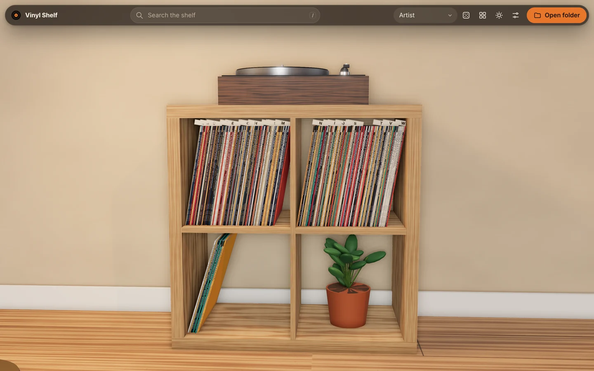
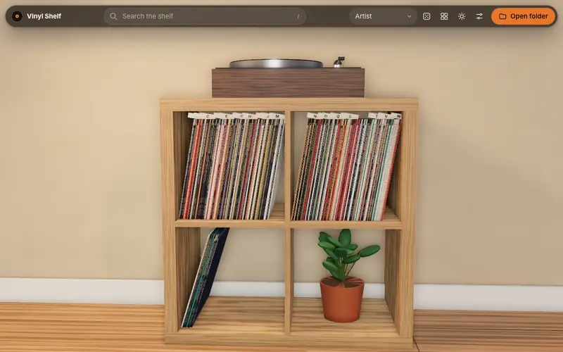
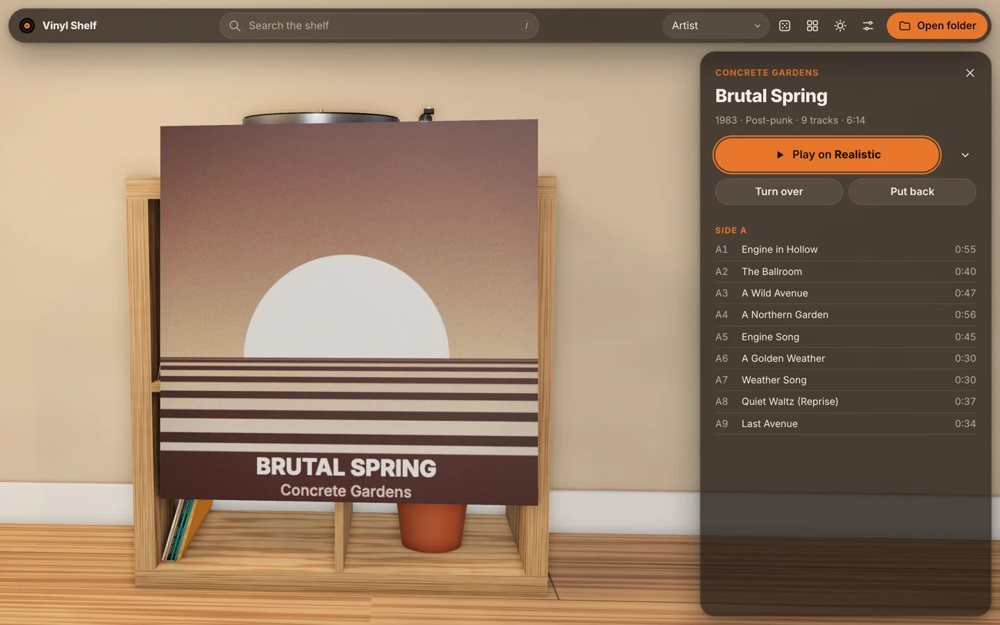

<div align="center">

# Vinyl Shelf

A 3D record shelf over your music folder. Pull out an album and it plays on a vinyl player.

[Try it](https://gitguy268.github.io/vinyl-shelf/?demo) · [Players](#the-players) · [Run it locally](#run-it-locally-step-by-step) · [How it works](#how-it-works) · [Protocol](docs/PROTOCOL.md)

[](https://github.com/Gitguy268/vinyl-shelf/actions/workflows/ci.yml)
[](https://gitguy268.github.io/vinyl-shelf/)
[](LICENSE)




</div>

<!-- live-links -->

**Live:** [gitguy268.github.io/vinyl-shelf](https://gitguy268.github.io/vinyl-shelf/) · [gitguy268-vinyl-shelf.vercel.app](https://gitguy268-vinyl-shelf.vercel.app)
<!-- /live-links -->

## What it does

Open your music folder and every album becomes a record on an oak cube shelf, in a room with a floor lamp and a turntable. Records stand in order with divider cards between the letters, and each spine takes its colours from the album's cover.

- **Pull a record out** to see its cover. Turn it over for the tracklist, split into side A and side B like a real LP.
- **Play it.** The record slides out of its sleeve onto the turntable on top of the shelf. The sleeve stands against the wall, and the album goes to the vinyl player of your choice beside the shelf.
- **Find things.** Search across artists, titles, genres, years and track names; sort by artist, title, year, genre or recently added; or let it pick a record for you.
- **It's all local.** The folder is read in your browser. Only tags and small covers are kept, in this browser, so the shelf is there next time. Nothing is uploaded.

<div align="center">

</div>

## The players

Each player is its own project. The shelf opens it with `?shelf` and hands it one album over the [vinyl-shelf/1 protocol](docs/PROTOCOL.md). The album plays beside the player's own saved library and never enters it.

| Player                                                                         | What it is                                                                    |
| ------------------------------------------------------------------------------ | ----------------------------------------------------------------------------- |
| [Realistic](https://github.com/Gitguy268/realistic-vinyl-player)               | A turntable that looks, moves and sounds like a real deck.                    |
| [Ultra-Realistic](https://github.com/Gitguy268/ultra-realistic-vinyl-player)   | A 3D Thorens TD 115 MK II with a modelled motor, tonearm and RIAA chain.      |
| [8-bit Vinyl](https://github.com/Gitguy268/8-bit-vinyl-player)                 | Pixel art in NES, Game Boy or C64 colours.                                    |
| [Vinyl Player](https://github.com/Gitguy268/Vinyl-Player)                      | The original: a spinning record, a tonearm and visualizers.                   |
| [8-bit Turntable and Chiptune Stage](https://github.com/Gitguy268/8bit-player) | Two chunky pixel players.                                                     |
| Your own                                                                       | Any page that speaks vinyl-shelf/1: type its address in Players and settings. |

<!-- run-steps:start -->

## Run it locally, step by step

1. **Use it without installing anything:** download `vinyl-shelf-web.zip` from the [latest release](https://github.com/Gitguy268/vinyl-shelf/releases/tag/latest), unzip it, and double-click `index.html`. The whole app is that one file.
2. **Or build it from source** (Node 22 or newer):

   ```sh
   git clone https://github.com/Gitguy268/vinyl-shelf.git
   cd vinyl-shelf
   npm ci
   npm start
   ```

   `npm start` builds `dist/index.html` and opens it at `http://localhost:4291`.

3. **Optional: try it without music** by adding `?demo` to the address: a shelf of 150 made-up records with short synthesized tunes.

<!-- run-steps:end -->

## Using it

|                         |                                                                                                                                                                                                                                                    |
| ----------------------- | -------------------------------------------------------------------------------------------------------------------------------------------------------------------------------------------------------------------------------------------------- |
| **Open folder**         | Picks your music folder. In Chrome and Edge the shelf can keep the folder and reconnect with one click; in Brave, Firefox and Safari you pick it again each visit, and only new or changed files are read. You can also drop a folder on the page. |
| **Drag, scroll, pinch** | Move along the shelf and closer to it. A trackpad scrolls sideways along the shelf.                                                                                                                                                                |
| **Click a spine**       | Pulls the record out. Click the sleeve, or **Turn over**, to see the back.                                                                                                                                                                         |
| **Play on …**           | Plays it on the chosen player; the arrow next to it picks another one. **Hide** keeps the music playing while you browse.                                                                                                                          |
| **List**                | The same albums as a grid of covers.                                                                                                                                                                                                               |

<details>
<summary><b>Keyboard</b></summary>

| Key                                                 |                                  |
| --------------------------------------------------- | -------------------------------- |
| <kbd>←</kbd> <kbd>→</kbd> <kbd>↑</kbd> <kbd>↓</kbd> | Move along the records           |
| <kbd>Enter</kbd>                                    | Pull out; on the button, play    |
| <kbd>F</kbd>                                        | Turn the sleeve over             |
| <kbd>Esc</kbd>                                      | Put it back                      |
| <kbd>/</kbd>                                        | Search                           |
| <kbd>R</kbd>                                        | A record at random               |
| <kbd>L</kbd>                                        | List view                        |
| <kbd>D</kbd>                                        | Daylight or dusk                 |
| <kbd>+</kbd> <kbd>−</kbd> <kbd>0</kbd>              | Closer, further, the whole shelf |

</details>

## How it works



<details>
<summary><b>Reading the folder</b></summary>

- The folder comes from the File System Access API where the browser has it (its handle is kept in IndexedDB), and from `<input webkitdirectory>` or a drop everywhere else.
- Tags are read with [music-metadata](https://github.com/Borewit/music-metadata): MP3, FLAC, M4A/AAC, Ogg, Opus, WAV, AIFF and more. Files without tags are named from their folders (`Artist/Album/01 - Title.mp3`).
- Tracks group into albums by album artist and album. `CD1`/`CD2` folders make one album. A compilation, or a folder of many artists, is filed under Various Artists.
- The index (tags, sizes, file times) is kept in IndexedDB `vinyl-shelf`. When the folder is picked again, a file whose path, size and time are unchanged keeps its tags, so a large library is back at once. Picking the folder above or below the old one works too.
- Covers come from `cover.jpg`, `folder.png`, `front.*` and similar files, then from the art inside the first track, and otherwise are drawn by the page in one of seven printed-sleeve styles. Each is kept as a 512 px JPEG with its two spine colours.

</details>

<details>
<summary><b>The room</b></summary>

- three.js r186, with physically based materials, a room environment map, shadows from the lamp and the window, ground-truth ambient occlusion and a little bloom. Lighter graphics on phones and small machines.
- The shelf is an oak cube unit that grows with the library: cubes fill in reading order, about 86 % full, and a cube that is not full leans its records. Spare cubes hold a plant, a speaker, books or a print.
- Every record on the shelf is one instance of a single mesh. All spines are painted into texture atlases, so thousands of albums cost a handful of draw calls.
- The page draws a frame only when something moves.

</details>

<details>
<summary><b>The hand-off</b></summary>

The shelf loads the player with `?shelf`, waits for it to say hello, then posts the album: the audio `File` objects in order, plus the title, artist, year, genre and cover. It posts only to the player's own origin. The player plays it without opening its saved library, and reports what it is playing, which turns the record on the shelf's turntable. Safari keeps a framed page silent until a click inside it; the player then shows a "Tap to drop the needle" button. The details, and how to make your own player speak it, are in [docs/PROTOCOL.md](docs/PROTOCOL.md).

</details>

## Privacy

Vinyl Shelf has no server, no account, no analytics and no requests to other sites. The page is one file with everything inside it. Your music is read from your computer by your browser. The only thing that leaves the page is an album you choose to play, sent to the player you chose. **Forget this folder** in settings removes everything the shelf kept.

## Limits

- Brave, Firefox and Safari can't keep the folder between visits; you pick it again, which is quick because unchanged files are not read again.
- Covers inside very large FLAC or WAV files take a moment the first time.
- Players are web pages: playback needs them reachable (online, or a local copy whose address you enter).
- The text on the spines is LP-sized, so it's small; hover over a spine, or search, to find a record.

## Development

```sh
npm run dev       # http://localhost:5291/?demo&debug
npm run verify    # lint, format, types, unit tests, build, NOTICE
npm run e2e       # a real music folder (made with ffmpeg) in Chromium, Firefox and WebKit, http and file://
```

See [CONTRIBUTING.md](CONTRIBUTING.md) for the layout of the code and the protocol tests.

## Contributing

Issues and pull requests are welcome; see [CONTRIBUTING.md](CONTRIBUTING.md) and the [code of conduct](CODE_OF_CONDUCT.md). Report security problems privately ([SECURITY.md](SECURITY.md)).

## Changes

See [CHANGELOG.md](CHANGELOG.md).

## Licence and attributions

[MIT](LICENSE), © Lucas Van De Weerd. The page bundles three.js, music-metadata (and its dependencies), idb and the Inter typeface (OFL); all are listed with their licences in [NOTICE](NOTICE). Every record on the demo shelf is made up, and its covers and tunes are generated by the page.
